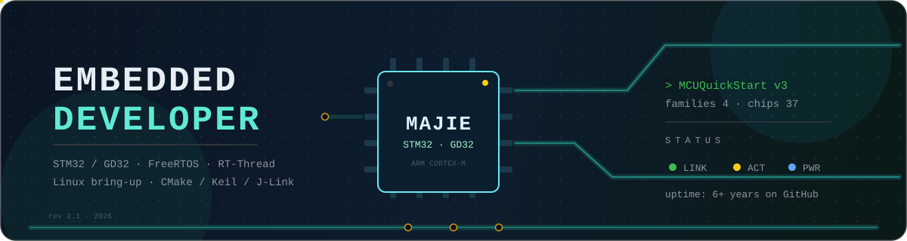

<div align="center">


# Majie

**MCU firmware · Embedded Linux · Board bring-up · RTOS tooling**

</div>



<div align="center">



</div>

```text
$ ls ~/toolchain/
```

<div align="center">

[](https://en.wikipedia.org/wiki/C_(programming_language))
[](https://www.kernel.org/)
[](https://www.arm.com/)
[](https://www.st.com/)
[](https://www.gigadevice.com/)
[](https://www.freertos.org/)
[](https://www.rt-thread.io/)
[](https://cmake.org/)
[](https://www.python.org/)
[](https://www.qt.io/)

</div>

```text
$ cat ~/current_work.md
```

Mostly embedded tooling and project setup experiments. One small example is [MCUQuickStart](https://github.com/Majie-xixi/MCUQuickStart), a STM32/GD32 project generator.

```text
$ ./fetch_stats.sh --user Majie-xixi
```

<div align="center">


</div>

```text
$ systemctl status contribution-snake
```

<picture>
  <source media="(prefers-color-scheme: dark)" srcset="snake/github-contribution-grid-snake-dark.svg">
  <source media="(prefers-color-scheme: light)" srcset="snake/github-contribution-grid-snake.svg">
  
</picture>

```text
$ mail -s "hello" mjie51939@gmail.com
```

<div align="center">

[](mailto:mjie51939@gmail.com)

</div>
